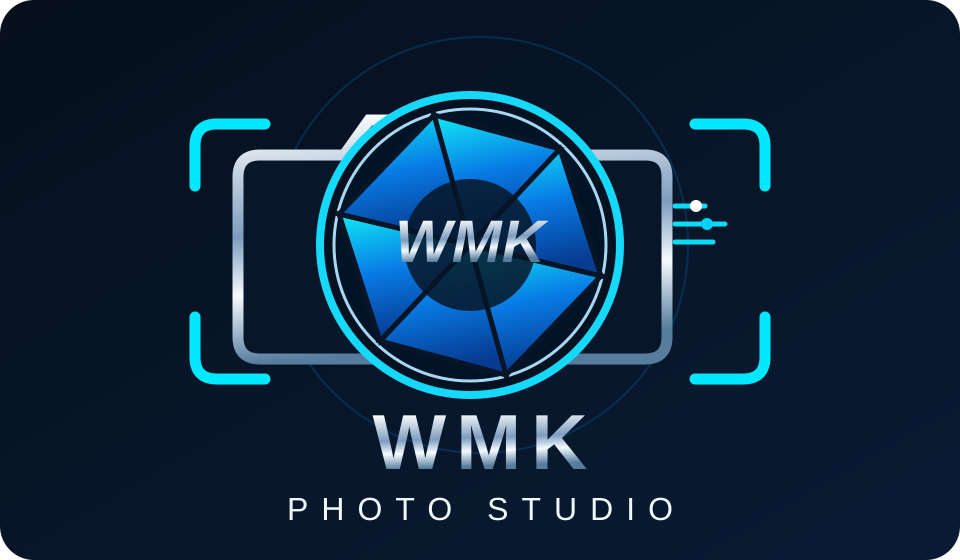

<p align="center"></p>

<h1 align="center">WMK Photo Studio</h1>
<p align="center"><strong>Editor de imagens e fotografias, livre e extensível, desenvolvido em Rust.</strong></p>
<p align="center">Interface em português brasileiro · Camadas e máscaras · PSD · Filtros · Automação · CLI/MCP</p>

> **Estado:** versão de estudos baseada no [PhotoCraft](https://github.com/storytold/photocraft), em fase **alpha**. Recursos podem estar incompletos. Faça cópias de segurança dos documentos importantes. A nova identidade não implica que toda a interface interna já tenha sido renomeada.

## O que é?

O WMK Photo Studio é um fork experimental do **PhotoCraft**, um editor nativo de imagens criado em Rust e inspirado nos fluxos de trabalho de editores profissionais. Esta distribuição se concentra em facilitar o acesso de usuários brasileiros, oferecer builds Windows e explorar automação e agentes de IA.

## Principais recursos da base PhotoCraft

- **Camadas e composição:** grupos, máscaras raster e vetoriais, transparência, modos de mesclagem, camadas de ajuste, efeitos e objetos inteligentes.
- **Pintura e retoque:** pincéis, ferramentas de clonagem, correção de imperfeições e recursos de seleção.
- **Fotografia:** curvas, níveis, saturação, filtros, redimensionamento, transformações e gerenciamento de cores.
- **Texto e desenho:** camadas de texto, formas, caminhos vetoriais e estilos.
- **Formatos:** PNG, JPEG, WebP, TIFF, PSD/PSB, SVG e formatos adicionais com suporte variável de leitura e escrita.
- **Automação:** ferramentas de linha de comando, processamento em lote, comandos JSON e servidor MCP.
- **Interface:** temas e painéis de edição; suporte a diferentes sistemas operacionais.

Alguns recursos listados são **parciais** na versão alpha. Veja [ROADMAP.md](ROADMAP.md) e [avaliação de compatibilidade](docs/target-app-parity.md).

## Baixar a versão Windows de estudos

Acesse **[Actions → WMK Windows Portable](https://github.com/WalneyNF/WMK-Photo-Studio/actions/workflows/wmk-windows.yml)**. Abra uma execução concluída com sucesso e baixe o artefato **WMK-Photo-Studio-Windows-x64**. Extraia o ZIP e execute `WMK-Photo-Studio.exe`.

O artefato só aparecerá **após uma compilação bem-sucedida**; este README não garante que já exista um executável. O Windows pode alertar sobre programas não assinados. Verifique a origem e não desative recursos de segurança para executar o aplicativo.

## Compilar no Windows

Pré-requisitos: Rust 1.95 ou posterior, toolchain MSVC e Visual Studio Build Tools com desenvolvimento C++. Para incluir as traduções, obtenha também o repositório [craft-i18n](https://github.com/storytold/craft-i18n).

```powershell
git clone https://github.com/WalneyNF/WMK-Photo-Studio.git
git clone https://github.com/storytold/craft-i18n.git
cd WMK-Photo-Studio
$env:CRAFT_I18N_DIR = (Resolve-Path ..\craft-i18n).Path
$env:CRAFT_I18N_REQUIRED = "1"
cargo build --release -p photocraft
```

O nome do pacote Rust continua `photocraft` para manter a compatibilidade com a infraestrutura do projeto original. O workflow WMK renomeia a cópia distribuída do executável. Compilações locais feitas diretamente com Cargo ainda podem mostrar a iconografia original enquanto a migração da marca não estiver completa.

## Idioma português

O catálogo **pt-BR já existe** no projeto compartilhado `craft-i18n`. Para escolher o idioma, acesse as preferências de interface. A tradução ainda não abrange todas as mensagens do motor. O workflow desta distribuição exige o catálogo de tradução durante a compilação.

## Acompanhar o desenvolvimento

- [Roadmap visual HTML](docs/roadmap.html)
- [Roadmap técnico WMK](docs/WMK-ROADMAP.md)
- [Manual: fotos em lote sem sobrescrever originais](docs/WMK-LOTE.md)
- [Código e testes da ferramenta de lote](wmk-tools/)

## Próximas melhorias

1. Build portátil Windows validado e ícones consistentes no aplicativo.
2. Tradução pt-BR integral e seleção automática do idioma.
3. Testes de leitura/escrita PSD e estabilidade.
4. Painéis e layouts personalizados persistidos.
5. Fluxos de retoque e processamento em lote.
6. Assistente de IA conectado ao mecanismo de comandos, com confirmação antes de ações destrutivas.
7. Recursos opcionais para criação de sprites e texturas de jogos.

## Documentação

- [Guia de compilação e identidade WMK](docs/WMK-COMPILACAO.md)
- [Roadmap original](ROADMAP.md)
- [Manual de desenvolvimento do projeto base](docs/development.md)
- [Documentação de localização](docs/localization-parity.md)

## Créditos e licenças

**Fork/identidade WMK:** Walney Moreira Klein — walneyk@hotmail.com.

**Projeto original:** [PhotoCraft / ArtCraft](https://github.com/storytold/photocraft) e seus colaboradores. Os direitos, avisos de atribuição e licenças originais devem ser preservados. O código-base declara **MIT OR Apache-2.0**; consulte [LICENSE-MIT](LICENSE-MIT), [LICENSE-APACHE](LICENSE-APACHE), [NOTICE](NOTICE) e [ATTRIBUTION.md](ATTRIBUTION.md). O nome e a identidade WMK não transferem a autoria do código original.
